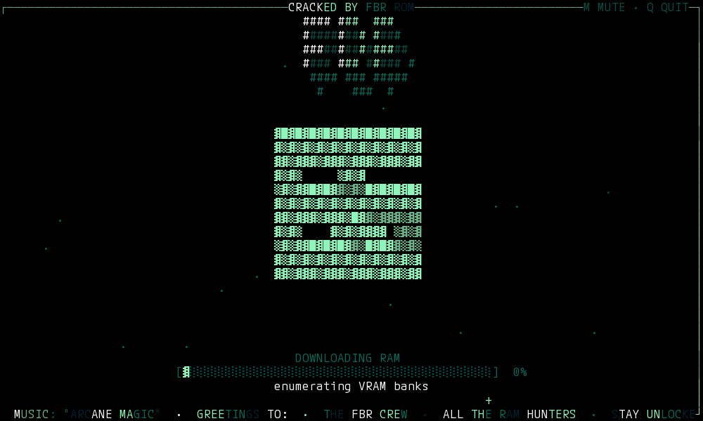

# FBR RAM Downloader NVIDIA

Live HBM2 memory clock unlock for every NVIDIA Tesla V100 in a machine — no VBIOS flash, no driver reload, no reboot — wrapped in a 4-color cracktro, with a `--headless` mode for scripts and systemd.



## Quick start

Try the simulated cracktro straight from a checkout (self-contained, no Rust/Nix/root required):

```sh
git clone https://github.com/FBR-ROM/FBR-RAM-Downloader
cd FBR-RAM-Downloader
./demo/run.sh
```

### Install (x86-64 Linux)

One command puts `fbr-ram-downloader` on your `PATH`, installs the static `v100-unlock` agent root-owned at `/usr/local/sbin/v100-unlock`, and writes a `/etc/sudoers.d/fbr-ram-downloader` rule for your user:

```sh
sudo ./install.sh
```

Options:

```sh
./install.sh --dry-run                 # preview without root
sudo ./install.sh --prefix /opt        # install to /opt instead of /usr/local
sudo ./install.sh --user arikami       # grant the sudoers rule to arikami
sudo ./install.sh --no-sudoers         # skip the sudoers rule
sudo ./install.sh --uninstall          # remove installed files and sudoers rule
```

`install.sh` is idempotent — re-run it after pulling updates.

### Nix

```sh
nix run .                  # run the cracktro directly
nix build .                # -> result/bin/fbr-ram-downloader
nix build .#agent          # -> result/bin/v100-unlock (Linux)
nix profile install .      # install into your nix profile
```

Or import the flake:

```nix
inputs.fbr.url = "github:FBR-ROM/FBR-RAM-Downloader";

environment.systemPackages = [
  inputs.fbr.packages.${system}.default   # cracktro
  inputs.fbr.packages.${system}.agent     # v100-unlock (Linux)
];
```

## Usage

```sh
fbr-ram-downloader --headless --dry-run   # safe first step: survey, write nothing
fbr-ram-downloader                        # real unlock, interactive cracktro
fbr-ram-downloader --sprint               # 1080 MHz (+23%) instead of 1053 MHz (+20%)
fbr-ram-downloader --headless             # real unlock, plain text (scripts / systemd)
fbr-ram-downloader --host c4130           # run on remote V100 host c4130 over ssh
fbr-ram-downloader --demo                 # simulated download: no hardware, no root
```

Keys in interactive mode: `q` / `Esc` / `Ctrl-C` quit (cancels and rolls back any changed cards), `m` mute/unmute, mouse drag spins the 3D model.

| Flag | Effect |
|------|--------|
| `--demo` | Simulated download: no hardware, no root |
| `--headless` | Stream `v100-unlock` plain text to stdout, no TUI |
| `--host HOST` | Run on V100 host `HOST` over ssh |
| `--dry-run` | Survey every card and report what would change; write nothing |
| `--sprint` | Target 1080 MHz instead of daily 1053 MHz |
| `--fast` | Skip status-line pacing in the cracktro |
| `--grey` | Grey Quarttrochrome palette (default: Green) |
| `--dark` / `--light` | Force terminal theme instead of OSC 11 auto-detect |
| `--music FILE` | Play a specific audio track (default: auto-detect `music/`) |
| `--no-music` | Start with music off |
| `--dump [N [W H]]` | Print N frames at W×H to stdout and exit |
| `--layout [W H]` | Print computed layout for W×H and exit |
| `-V`, `--version` | Print version and exit |
| `-h`, `--help` | Print usage and exit |

Exit codes (`--headless` and `v100-unlock`): `0` at target (or dry run), `2` refused / nothing changed (or bad flags), `3` rolled back to starting clocks, `4` unknown hardware state (power-cycle host).

### `v100-unlock` directly

```sh
v100-unlock status                # measure every card's live clock (read-only)
v100-unlock apply                 # raise to 1053 MHz (+20%)
v100-unlock apply --sprint        # raise to 1080 MHz (+23%)
v100-unlock apply --dry-run       # survey and report, write nothing
v100-unlock restore               # return to stock clocks
v100-unlock apply --demo          # 4-card simulated run (no hardware, no root)
```

Additional flags: `--card BDF` (repeatable), `--simulate N`, `--events`.

### Apply on boot (systemd)

```ini
# /etc/systemd/system/v100-unlock.service
[Unit]
Description=Raise Tesla V100 HBM2 memory clock to 1053 MHz
After=multi-user.target

[Service]
Type=oneshot
ExecStart=/usr/local/bin/fbr-ram-downloader --headless

[Install]
WantedBy=multi-user.target
```

```sh
sudo systemctl enable --now v100-unlock.service
```

## The numbers & how it works

| Mode | Memory clock | Bandwidth |
|---|---:|---:|
| stock | 877.5 MHz | 898 GB/s |
| daily (default) | 1053 MHz | +20% |
| `--sprint` | 1080 MHz | +23% |

NVIDIA locked V100 memory clocks in the driver at 877.5 MHz even though the same GV100 silicon runs at 1107 MHz in the V100S. With root access to PCI BAR0, a single write of the HBM PLL multiplier (`27 MHz × NDIV / 2`) to the write-only multicast register `0x98BC98` switches all 16 memory partitions live in ~0.1 ms — no VBIOS flash, no driver reload, no reboot.

Safety invariants:
- **Verified by hardware counters**: after all 16 partition PLLs lock, `v100-unlock` measures the real clock from each card's 36-bit DRAM cycle counters (no CUDA needed) and requires every PLL to land within 1 MHz of target.
- **All-or-nothing rollback**: if any card refuses, fails to lock, measures off-target, or you cancel (`q`, `Ctrl-C`, `SIGTERM`, `SIGHUP`, or closed stdin), every touched card is written back to its starting clock.
- **Volatile**: nothing is written to firmware; a reboot or `v100-unlock restore` returns stock clocks.

Validated on 4× V100-SXM2-16GB (`1053 MHz` daily memtest-clean, `+10.1%` plain decode and `+8–9%` speculative decode, byte-identical to stock; `1107 MHz` threw errors). All Tesla V100 PCI IDs are supported (the FHHL ships at 810 MHz, so daily is `+30%`; V100S at 1107 MHz is left untouched). Faster memory, not more: VRAM capacity does not change.

For how the cracktro and pluggable `Hack` trait are structured, see [ARCHITECTURE.md](ARCHITECTURE.md).

## Building & testing

With Nix:

```sh
nix develop
cargo test --workspace    # unit tests, 250+ size frame sweep, 3,000-run chaos soak, CLI & bundle tests
cargo build --release     # build the cracktro
```

Without Nix, install Rust (via [rustup](https://rustup.rs) or your distro) plus `pkg-config` and ALSA dev headers (`libasound2-dev` on Debian/Ubuntu, `alsa-lib-devel` on Fedora, `alsa-lib` on Arch, `alsa-lib-dev` on Alpine), then run `cargo test --workspace` and `cargo build --release`.

To rebuild the static musl agent and refresh `demo/`:

```sh
rustup target add x86_64-unknown-linux-musl
cargo build -p v100-unlock --release --target x86_64-unknown-linux-musl
cp target/release/fbr-ram-downloader demo/
cp target/x86_64-unknown-linux-musl/release/v100-unlock demo/
```

## Credits

- [amoghmunikote/cmpunlocker](https://github.com/amoghmunikote/cmpunlocker) (GPL-2.0): runtime unlock of CMP 170HX.
- [asm64-hooligan/cmpunlocker (`mem_overclock`)](https://github.com/asm64-hooligan/cmpunlocker/tree/mem_overclock) (GPL-2.0): single multicast write to `0x98BC98` and memory PLL map.
- [cachenetics/170tune](https://github.com/cachenetics/170tune) (MIT): userspace write sequence, all-ones false-lock check, write-back on timeout, exit codes. See [NOTICE](NOTICE).
- [duggasco/CMP100-210](https://github.com/duggasco/CMP100-210) (PolyForm Noncommercial / CC BY-NC): GV100 `PMC_BOOT_0` canary, write-only `0x98BC98`, per-partition PLL layout (no code included).
- `v100-overclock`: GV100 live `0x98BC98` verification, CUDA-free DRAM cycle counter meter, and 4× V100-SXM2-16GB qualification.

Greetings: Amp Code, Defame, DNV, Eth Strat, Franck (TP art), Gary, Gina, Helix Collective, Jeeva, Jensen Huang, Manik, Nvidia, Nous Research, Onslaught, Rob, Stableshaman, Thinking Machines, Ziggy.

<3 FBR ROM

## License

Public domain under the [Unlicense](LICENSE).
